## 1. Create a Docker container image
- Website built by ChatGPT, `Build a complete themed website with an index page, a second page and a css page`
- Website on space exploration and the solar system, includes information on space exploration and solar system.
- [index.html](web-content/index.html) - Main home page
- [about.html](web-content/about.html) - Contains the information about the planets
- [style.css](web-content/style.css) - Stylesheet used for both pages.
---
- [Dockerfile](Dockerfile) uses the httpd:2.4 server and copies all the contents of the website into the default web directory for apache
- Instructions to build and push the container image to your DockerHub repository
    1. On your Docker account go to account setting.
    2. Go to Personal Access Token and Generate New Token.
    3. Make it so it is set to read and write so you can make changes later. Make sure this key isn't shared.
    4. On terminal go to the active working directory where the code is stored.
    5. On terminal run `docker build -t apatel1406/aws-lb:latest .`
    6. Go to hub.docker.com and click create new repository.
    7. The image should show up, if not run `docker build -t apatel1406/aws-lb:latest .` again, then it should.
    8. Run the container, 
       `docker run -d --name project6-web -p 8080:80 apatel1406/aws-lb:latest`
    9. Open a browser and go to `http://localhost:8080` to view the website.

- [Docker Repository](https://hub.docker.com/repository/docker/apatel1406/aws-lb/general)

- Links Used
    1. [Docker Image & Container Help](https://docs.docker.com/build/concepts/dockerfile)
    2. [Building, Tagging and publishing a dockerfile image](https://docs.docker.com/get-started/docker-concepts/building-images/build-tag-and-publish-an-image/)

## 2. GitHub Actions and DockerHub
- Configuring Github Repo Secrets
    - How to create a PAT for authentication
        - 1. Go to dockerhub
        - 2. Open `Sccount Settings`
        - 3. Go to `Personal Access Token`
        - 4. Click `Create New Token`
        - 5. Set name and set as `Read & Write`
        - 6. Copy the token and put it somewhere safe. 
    - How to set repository Secrets for use by GitHub Actions
        - 1. On your repository go to Settings 
        - 2. Click on `Secrets and Variables `> Actions
        - 3. Click `New Repository Secret`
        - 4. Add the Secret Name and value 
        - 5. Do this for both USERNAME and TOKEN
    - Describe the Secrets set for this project
        - In this case, Secret = `DOCKER_USERNAME`, Value = `apatel1406` and Secret = `DOCKER_TOKEN`, Value = `Dockerhub Generated Token` 
---
- CI with Github Actions
    - I created a Github actions workflow file called [Docker-build.yml](../.github/workflows/docker-build.yml) This code runs everytime something is pushed to the main brunch
    - Workflow Steps
        - Checkout: Uses `actions/checkout@v6` to access the repo files
        - Login To Docker Hub: Uses `docker/login-action@v4` and the repo secrets added earlier as the username and password to authenticate with Dockerhub
        - Build and Push: Uses `docker/build-push-action@v7` to build the docker image from the Project6 folder and pushes it to dockerhub with the latest tag
    - Values that may need to the updated if used in a different repo
        - `Branch` may need to updated if pushed to another branch besides main.
        - `Context` needs to be changed to a different repo folder
        - `Tags` need to be changed to match the dockerhub username and repo name if changed
    - Link to Workflow File 
        - [Docker-build.yml](../.github/workflows/docker-build.yml)
    - Permalink 
        - https://github.com/WSU-kduncan/ceg3120-cicd-patel1599-f26/blob/4f7f32345b369c1af2a53f13c2b5702d10346ff8/.github/workflows/docker-build.yml
---
- Testing and Validation
    - Test the workflow by pushing changes to the main branch and in the github actions tag we should see a new workflow with the green checkmark. 
    - Also checked that it didn't work using a test-branch. 
    - To verify the docker image, i pulled the image from dockerhub and ran it as a conatiner. One thing to remember is that port 8080 is already taken up with the original image, and if we want to really test then we would run using 8081:80
    - [Docker Repo](https://hub.docker.com/r/apatel1406/aws-lb)
---
- Links Used
    - [Sample-Workflow](https://github.com/pattonsgirl/CEG3120/blob/main/Projects/Project6/sample-workflows/docker-workflow-v2.yml)
    - [Building and Pushing Docker Images](https://github.com/marketplace/actions/build-and-push-docker-images)
    - [Publishing Docker Images](https://docs.github.com/en/actions/tutorials/publish-packages/publish-docker-images#publishing-images-to-docker-hub)
    - [Publishing and Exposing Ports](https://docs.docker.com/get-started/docker-concepts/running-containers/publishing-ports)

## Part 3. Semantic Versioning
- Generating Tags
    - Git tags are used to identify versions of a project. 
    - To see tags on github
        - 1. `git tag` > To see tags
        - 2. `git tag v1.0.0` > Create a new tag
        - 3. `git push origin v1.0.0` > Push tag to gitub
---
- Semantic Versioning Container Images with GitHub Actions
    - Workflow
        - Checkout: Uses `actions/checkout@v6` to access the repo files
        - Login To Docker Hub: Uses `docker/login-action@v4` and the repo secrets added earlier as the username and password to authenticate with Dockerhub
        - Docker Meta: Uses `docker/metadata-action@v5` to generate docker image tages that match teh Git tags
        - Build and Push: Uses `docker/build-push-action@v7` to build the docker image from the Project6 folder and pushes it to dockerhub with the latest tag
    - Values that may need to the updated if used in a different repo
        - `DOCKER_USERNAME`: Change this to the DockerHub username.
        - `DOCKER_TOKEN`: Use a PAT belonging to that DockerHub account.
        - `images: apatel1406/aws-lb`: Change this to the correct DockerHub username and repository name.
        - `context: ./Project6`: Change this if the Dockerfile is located in a different folder.
        - `tags: 'v*'`: Change this if a different version tag format is used.  
    - Link to Workflow File 
        - [Docker-build.yml](../.github/workflows/docker-build.yml)
---
- Testing and Validating
    - I tested the workflow by creating and pushing two Git tags, `v1.0.0` and `v1.1.0`. Both GitHub Actions workflow runs completed successfully.
    - On DockerHub the repo showed the generated image tags for both releases and matched the github tags. 
    - [Link to DockerHub Repo with Tags](https://hub.docker.com/repository/docker/apatel1406/aws-lb/tags)
---
- Links Used
    - [Manage Tags adn Labels with Github Actions](https://docs.docker.com/build/ci/github-actions/manage-tags-labels/)
    - [Docker Meta and Github Actions](https://github.com/docker/metadata-action?tab=readme-ov-file#semver)
    - [Tages and Releases](https://docs.codeberg.org/git/using-tags/)
    - [Github Actions 101](https://github.com/pattonsgirl/CEG3120/blob/main/CourseNotes/github-actions.md) 
## Part 4. Project Description & Diagram
- Continuous Integration Project Overview
    - The goal of this project is to use Docker and Github actions to build and publish a website continer image to Dockerhub
    - Semantic versioning is also used in this project to create different versions of the Docker image. This allows older versions of the website to be pulled and run when needed.
    - I used Apache HTTP server that contains two HTML pages and one css page. Github Actions automatically builds and pushed the docker image to DockerHub when changes are made or a new version is made. 
---
- Model 
    - 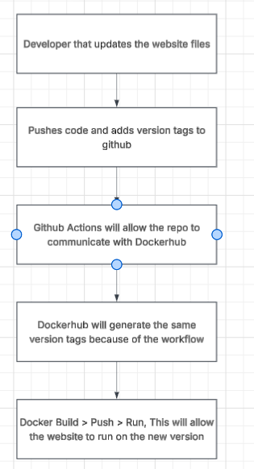
---
- Links Used
    - [Diagram Model](https://github.com/pattonsgirl/CEG3120/blob/main/CourseNotes/github-actions.md) 

## Testing and Proof
- Part 1
    - Website Homepage
    - 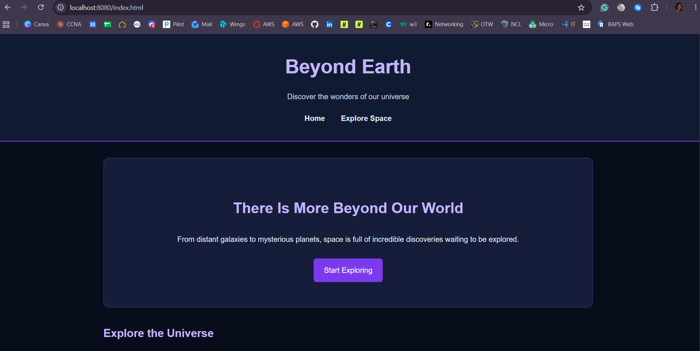
    - About Page
    - 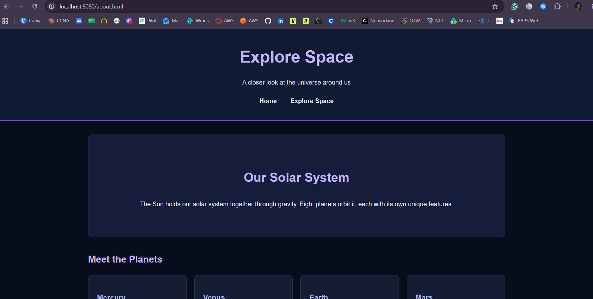
    - Running Docker Container
    - 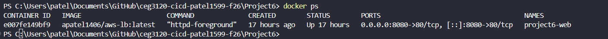
    - Dockerhub Repo
    - 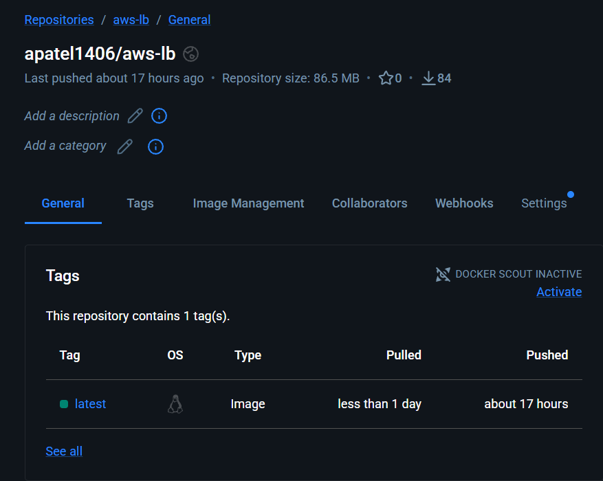
    - Pulling Docker Image
    - 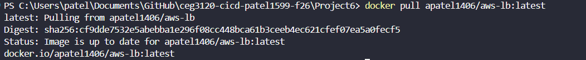
- Part 2
    - Github Action Workflow
    - 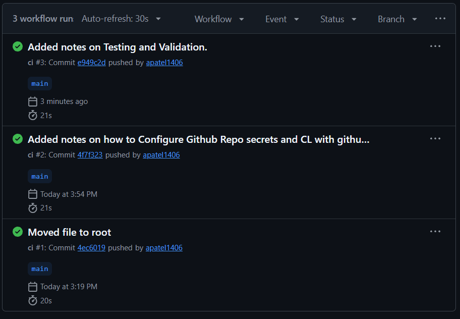
    - Test Branch 
    - 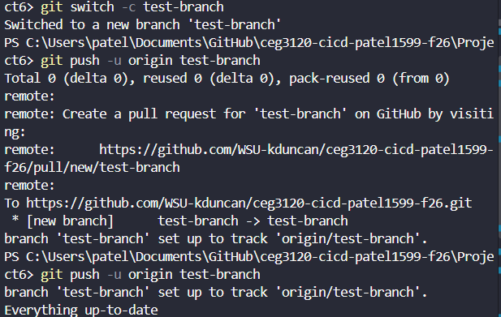
    - Pull Test
    - 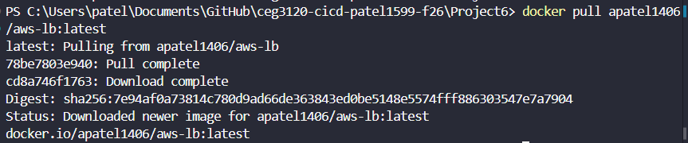
    - Container Test
    - 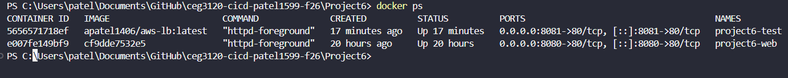
- Part 3
    - Successful Workflow 1.0.0
    - 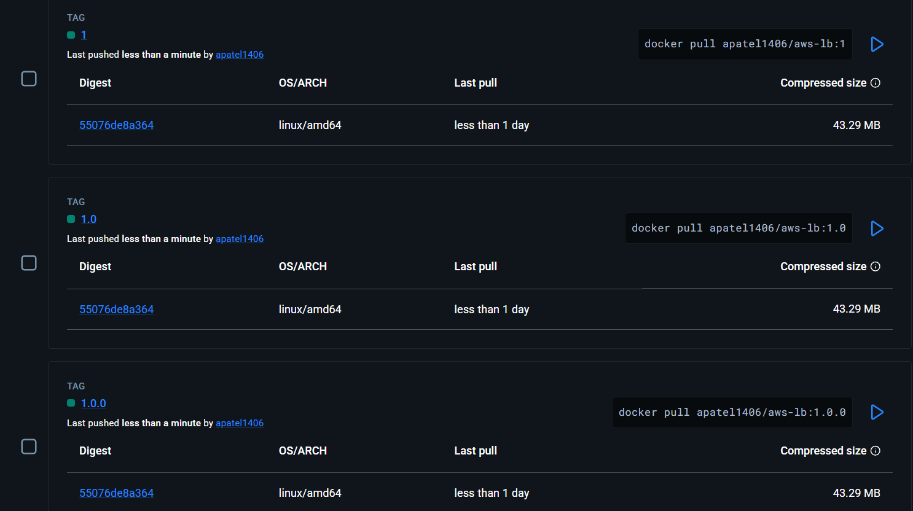
    - Successful Workflow 1.1.0
    - 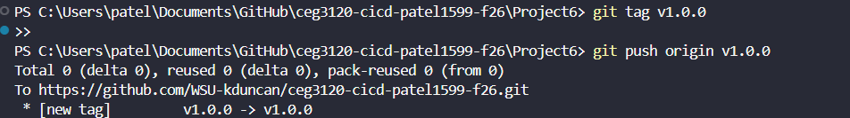
    - Dockerhub Version Tags
    - 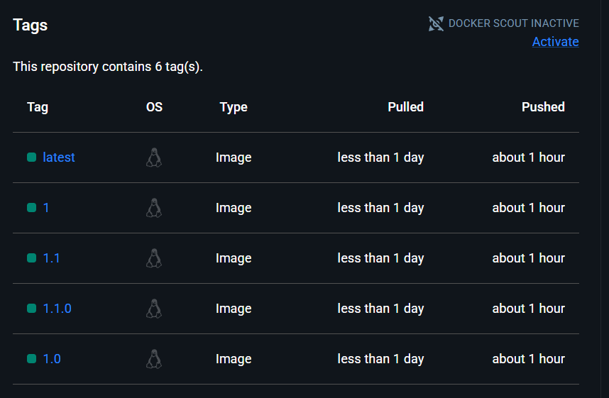
    - Version 1.1.0 Website
    - 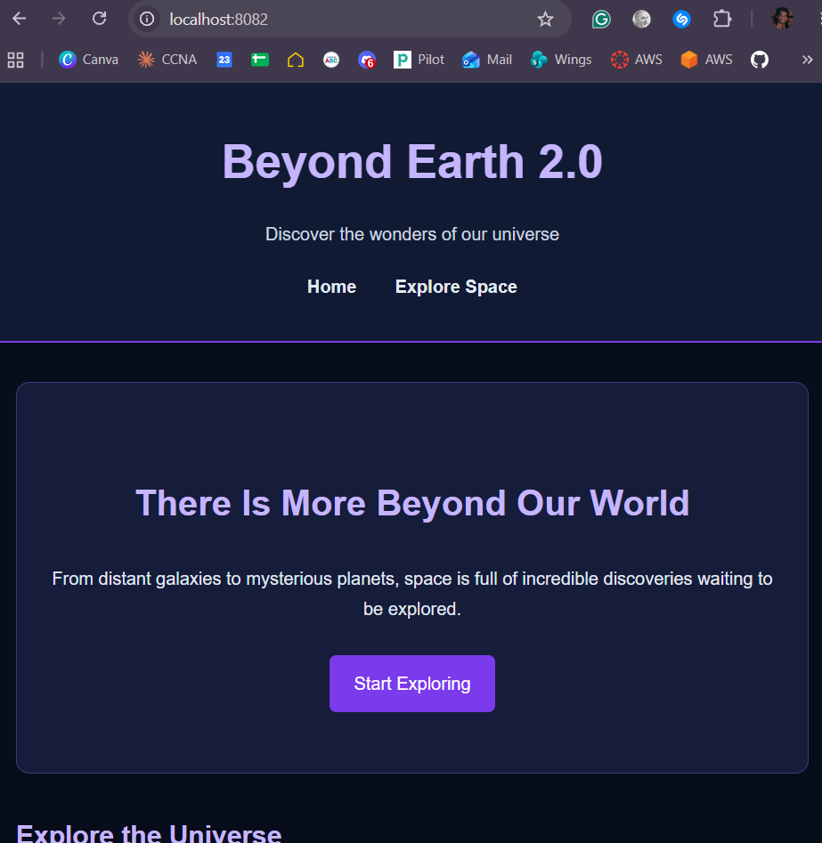
    - Version 1.0.0 Rollback
    - 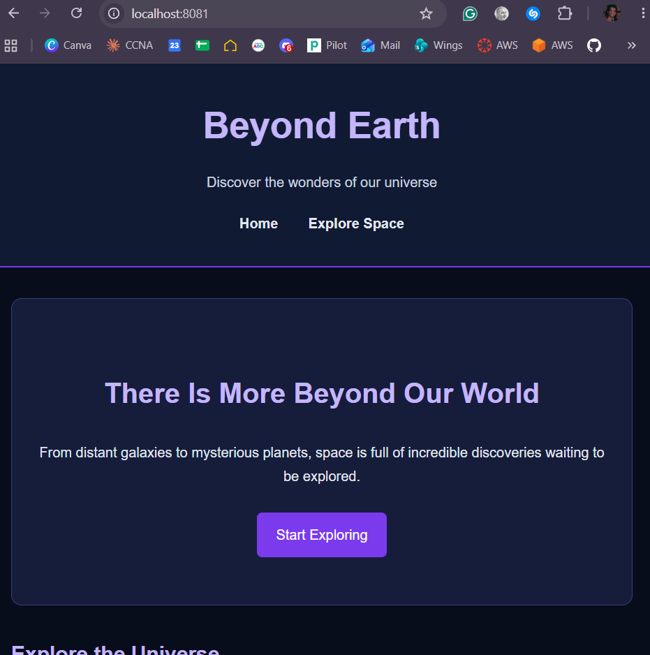